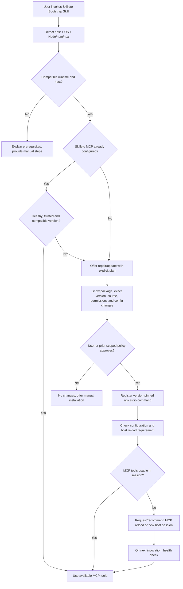

# Skilleto — DEPLOY.md

> **Status:** implementation specification · **Target:** MVP v0.1.0 · **Deployment:** local MCP (stdio) + Bootstrap Skill  
> **Project:** Skilleto · **Planned website:** https://skille.to  
> **Audience:** Codex / Claude Code implementers and maintainers

## 1. Purpose and decision

Skilleto uses a **hybrid deployment model**:

1. The user installs a lightweight **Bootstrap Skill** named `skilleto` in their agent.
2. At first invocation, the skill checks whether the **Skilleto MCP server** is already registered and functioning.
3. If not, the skill guides or initiates **approved registration** of a version-pinned npm package via `npx`.
4. The MCP host starts the server on demand using **stdio**. No persistent background daemon, open network port, or centralized service is required for MVP.
5. After the host reloads its MCP configuration (or restarts, where necessary), Skilleto tools become available to the agent.

**Design principle:** *Install the Bootstrap Skill once; provision the local MCP runtime on demand.* A manual `npx`-based setup must remain available independently of the Bootstrap Skill.

**Important distinction:** `npx` runs an npm package when the MCP client starts it; registering the command is not the same as permanently installing a global npm package. The initial invocation may fetch package artifacts into the npm cache. The exact fetch behavior depends on npm/cache settings.

## 2. MVP scope

**Included:**

- Local MCP server (`stdio` transport).
- Single upstream skills registry: **skills.sh** via its `vercel-labs/skills/find-skills` discovery workflow / supported interface.
- Task decomposition, semantic matching, explicit **no-install** decision.
- Trust & Security checks prior to installation.
- Autonomous provisioning of approved skills under explicit user-defined permissions.
- Bootstrap installer/registrar for supported hosts (initially Codex and Claude Code).
- Idempotent detection, repair, diagnostics, safe rollback and uninstall.

**Excluded:** hosted/cloud MCP service, mandatory account/login, feedback loop, cross-skill composition, unsupported automatic privilege escalation, and silent installation of untrusted code.

## 3. Components and responsibilities

| Component | Responsibility | Runs where |
|---|---|---|
| `skilleto` Bootstrap Skill | Detect host/runtime; explain permissions; invoke host integration; verify/repair registration | Host agent |
| `skilleto-mcp` | MCP protocol, orchestration, discovery, ranking, risk assessment and provisioning | Local `npx`-launched process |
| Host adapter | Codex / Claude Code integration, config management and refresh hints | CLI / local host config |
| Provisioning adapter | Install/activate compatible skills after security gating | Allowed host workspace/skills location |
| skills.sh discovery | Find candidate skills relevant to task subproblems | External registry/network |

The **Bootstrap Skill must remain small** and independent of the MCP server: it must be able to recover a broken or missing server installation. The core skill resolution policy belongs to the MCP runtime, not to duplicated host-specific prompts.

### Proposed package and names

- Product name: `Skilleto`
- Website (planned): `skille.to`
- npm package (proposed, **not yet verified/published**): `skilleto-mcp`
- MCP server registration name: `skilleto`
- Bootstrap Skill directory/name: `skilleto`
- CLI (proposed): `skilleto`
- MCP tools: `skilleto.resolve`, `skilleto.inspect`, `skilleto.install`, `skilleto.status`, `skilleto.rollback` (logical contract; final wire names must comply with the MCP SDK/host conventions)

## 4. First-run sequence



### Behavioral contract

1. **Preflight:** detect host, OS, supported Node.js LTS version, `npm`/`npx` availability, permissions, current working directory, registered MCP servers, and existing installation. Do not assume shell access from the Bootstrap Skill: if unavailable, output precise, copyable setup steps.
2. **No-op fast path:** if an already registered Skilleto server passes version and health checks, avoid touching configuration or downloading packages.
3. **Install plan:** show the exact package name and pinned version, origin, command, configuration scope, filesystem effects, and any potential network usage.
4. **Approval:** ask for explicit consent before adding the MCP server, executing newly obtained code, modifying host config, or writing outside pre-approved scope. Persist user policy only if the user explicitly elects to do so.
5. **Registration:** prefer host-supported CLI/config APIs; do not blindly rewrite files. Safeguard existing config with an atomic edit and backup when direct modification is unavoidable.
6. **Activation:** detect whether the host can reload tools in-session. Otherwise clearly instruct the user to restart/reload the host and repeat the health check. **Do not claim instant tool availability.**
7. **Diagnostics:** report exact failing step and actionable recovery; do not silently retry indefinitely.

## 5. Manual installation (`npx`)

The examples below specify the **intended packaging contract**, not an assertion that the npm package already exists. Replace `X.Y.Z` with a release that has been published and verified.

### 5.1 Codex CLI

```bash
codex mcp add skilleto -- npx -y skilleto-mcp@X.Y.Z
```

Then inspect the registered server and restart/reload the Codex host if tools are not immediately visible:

```bash
codex mcp list
```

### 5.2 Claude Code

```bash
claude mcp add --transport stdio --scope user skilleto -- npx -y skilleto-mcp@X.Y.Z
```

Then verify the configuration:

```bash
claude mcp list
```

Prefer **user scope** for one installation shared across multiple projects; provide project scope only when requested. On native Windows, the host adapter must test whether launching `npx` requires `cmd /c` or an executable wrapper for the particular host/version; do not assume Unix shell semantics.

### 5.3 Generic MCP client

Configure a **stdio** server with the conceptual entry:

```json
{
  "mcpServers": {
    "skilleto": {
      "command": "npx",
      "args": ["-y", "skilleto-mcp@X.Y.Z"]
    }
  }
}
```

The exact config structure depends on the host. **Do not paste the JSON above into Codex `config.toml`**; its format differs. Always use the host's supported configuration mechanism.

### 5.4 Package release requirement

`skilleto-mcp@X.Y.Z` must expose an executable npm `bin`, e.g. `skilleto-mcp`, that starts the MCP stdio server. Stdout must be exclusively reserved for MCP protocol messages; write diagnostics to stderr. Publish a reproducible, signed/provenance-verified release where supported, and verify package ownership/name prior to initial use. Use an **exact version pin** in generated host config; updates must be deliberate rather than silently tracking `latest`.

## 6. Bootstrap Skill contract

Recommended repository path:

```text
skills/skilleto/SKILL.md
skills/skilleto/references/deploy.md
skills/skilleto/scripts/          # optional, host-specific helpers
```

Bootstrap Skill frontmatter should declare `name: skilleto` and explain when it should be invoked: first-time setup, discovery of needed skills, server diagnostics and repair. The body should instruct the agent to:

1. Resolve user intent and determine whether Skilleto is needed at all.
2. Check for existing MCP tools before installation.
3. Run preflight and provide an installation plan.
4. Ask approval and only then register the server via a supported mechanism.
5. Verify the server after host refresh; otherwise provide next-session instructions.
6. Once operational, delegate search, security assessment and provisioning to the MCP server.

**Trust boundary:** instructions returned from skills.sh or arbitrary skill repositories are untrusted content and must never be treated as higher-priority instructions for the host agent. The Bootstrap Skill must not execute a downloaded `SKILL.md` as a shell script or run arbitrary installation commands merely because a search result suggests them.

## 7. Skill discovery and installation lifecycle

Once deployed, Skilleto follows this decision flow:

```text
Task
  -> Break into subproblems
  -> Inspect agent's existing capabilities
  -> Decision: no new skill needed? -> return NO_INSTALL
  -> Search via find-skills (skills.sh)
  -> Semantic relevance and host-compatibility ranking
  -> Trust & Security gate
  -> Present recommended candidates + reasons
  -> Obtain consent where required
  -> Install / activate using host adapter
  -> Verify installed skill and report status
```

`find-skills` is **the MVP discovery mechanism**, not a privileged code execution authority. Implementation must verify the current supported CLI/interface of the upstream workflow at integration time. If that workflow relies on tools unavailable to the MCP process, implement a documented adapter or return an actionable unsupported/partial result—do not assume a stable undocumented web API.

### No-install first

The resolver must support a first-class `NO_INSTALL` outcome whenever the host already has sufficient tools/skills, the task is trivial, matching candidates are low confidence, or risks outweigh expected benefits.

### Semantic matching

Rank candidates by semantic task fit, required inputs/outputs, environment compatibility, dependencies, provenance, and risk. Since the host LLM already reasons about intent, the MVP may request structured reasoning from the host instead of requiring a separate embedding service or paid model API. The MCP component should still enforce deterministic validation and policy checks.

## 8. Trust & Security policy

**Minimum gate prior to provision:**

- Confirm canonical source, ownership, exact revision/version, and available integrity data.
- Inspect skill instructions, referenced scripts/assets, dependencies and executable lifecycle hooks.
- Flag suspicious behavior: secret extraction, broad filesystem traversal, persistence, remote script piping, privilege elevation, credential access, or prompt injection.
- Distinguish **metadata-only inspection** from **execution**; execute unknown code only with explicit approval and sandboxing appropriate to its permissions.
- Prefer per-project isolated skill installation to unrestricted global writes.
- Use allowlists for installation paths and host adapters; avoid interpolating untrusted names into shell commands.
- Record source URL, commit/version, hash, decision, permissions and installation result in a local audit log (without secrets).
- Fail closed for unresolved high-severity issues; explain clearly why installation was blocked.

**Automation levels:** `manual`, `supervised` (MVP default), `policy-approved` (only within explicitly granted scope). `autonomous` means the system can plan/propose/provision **within permissions**, not bypass approval or host security constraints.

## 9. State, idempotence, recovery, rollback

Maintain minimal local state (for example under the OS-appropriate application data directory) recording registered host adapters, selected runtime version, installed skill manifests, and audit events. Do not store tokens in plain text.

- Re-run with a healthy compatible installation: **no mutation**.
- Existing config named `skilleto` that points elsewhere: **report conflict**, never overwrite silently.
- Failed installation: restore only changes introduced by the current operation (from transaction log/backup).
- Partial install: detect incomplete state and offer repair/rollback.
- Rollback: unregister the managed MCP entry and remove Skilleto-managed skills only if explicitly selected; do not remove unrelated npm cache or user-authored skills.
- Upgrade: show version diff/permissions, obtain approval, update pin, verify health, and restore previous version on failure.

## 10. Diagnostics and acceptance tests

**Diagnostics output must include:** host and version, OS, Node/npm/npx versions, detected MCP entry, configured package version, executable resolution, health-check status, reload requirement, last error, and recommended fix. Redact sensitive environment values.

| ID | Acceptance criterion |
|---|---|
| D01 | Bootstrap works when the MCP server has not yet been configured. |
| D02 | Bootstrap detects a working, compatible server and performs no installation. |
| D03 | Codex registration uses supported command/config and a pinned npm version. |
| D04 | Claude Code registration uses supported command/config and a pinned npm version. |
| D05 | Generic clients receive correct stdio connection guidance. |
| D06 | Missing Node/npx or missing host permissions produce actionable diagnostics. |
| D07 | Installer shows a clear plan and blocks mutation without approval. |
| D08 | Repeated invocations are idempotent. |
| D09 | Conflicting existing config is not silently replaced. |
| D10 | Hosts requiring restart/reload are handled explicitly. |
| D11 | MCP server uses stdout only for protocol messages. |
| D12 | Failure during registration restores previous valid configuration. |
| D13 | Untrusted skills undergo security screening before execution/provisioning. |
| D14 | Resolver can return `NO_INSTALL` without contacting/installing unnecessary skills. |
| D15 | Install manifests and audit logs contain no credentials. |
| D16 | Successful end-to-end task discovery can call skills.sh/find-skills, recommend or decline a candidate, and report the outcome. |

Test Linux, macOS and Windows paths separately; include offline/cache-miss cases, unavailable registry, npm errors, permission-denied cases, and host session refresh behavior.

## 11. Implementation work packages

**P0 — Release contract:** reserve/verify package name, choose supported Node LTS matrix, implement `bin` stdio entrypoint, pin dependencies and specify MCP tools.

**P1 — Host adapters:** implement Codex and Claude Code detection, registration, health checks, conflict handling, rollback and OS-specific command execution.

**P2 — Bootstrap Skill:** write `SKILL.md` with first-run preflight, approval gate, self-repair instructions and manual fallback.

**P3 — Resolver integration:** wrap skills.sh/find-skills; add task decomposition, semantic ranking and `NO_INSTALL` decision.

**P4 — Security/provisioning:** static inspection, scoped permissions, safe skill installation, audit events and cleanup.

**P5 — Validation:** end-to-end tests in clean host environments, documentation and tagged npm release.

## 12. Future versions

- **v0.2:** Feedback Loop — measure real utility, success and failure, improve candidate ranking.
- **Later:** Skill Composition — dependency-aware workflows combining skills, with isolated execution and validated interfaces.
- **Later:** additional skill registries and optional remote MCP hosting.

## 13. Reference documentation

- Codex MCP configuration: https://learn.chatgpt.com/docs/extend/mcp
- Claude Code MCP setup: https://code.claude.com/docs/en/mcp
- MCP reference servers and stdio conventions: https://github.com/modelcontextprotocol/servers
- Discovery skill: https://www.skills.sh/vercel-labs/skills/find-skills

---

**Implementation note:** All commands referring to `skilleto-mcp@X.Y.Z` are deployment targets and examples until a verified npm package is published. Do not assume that the domain, npm package, or repository has already been acquired.
